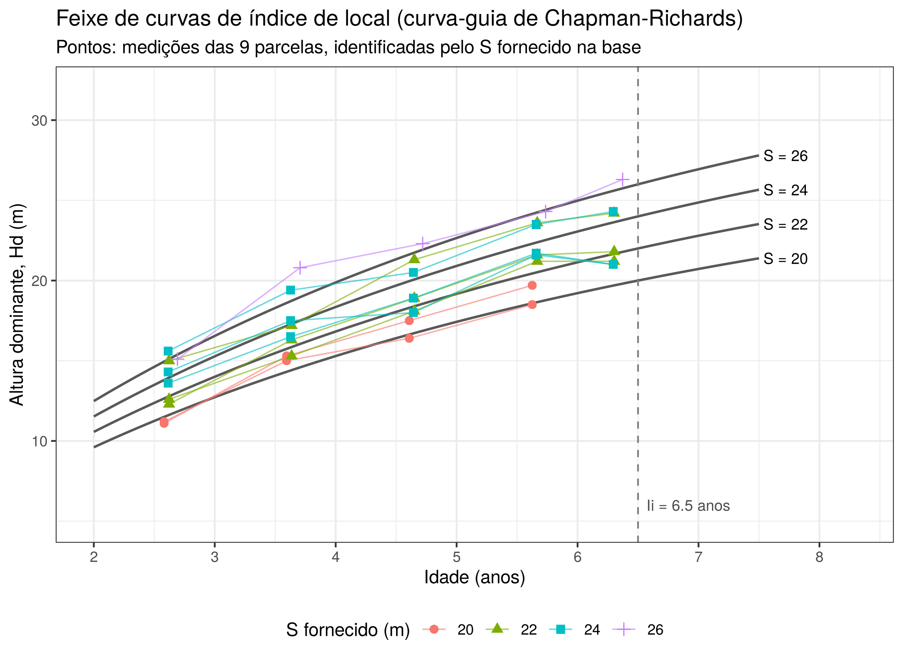
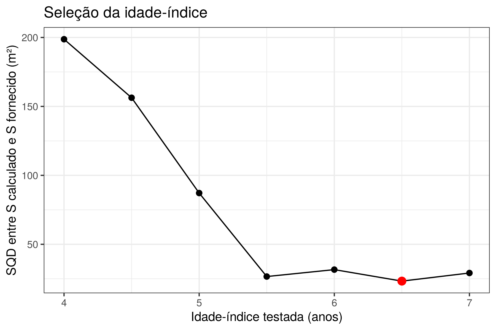

<div align="center">

# 🌲 Desafio 08 — Validação do índice de sítio

**Curva-guia e preparação da base para o modelo de Clutter**

   

*Disciplina Mensuração Florestal · Programa de Pós-Graduação em Ciências Florestais · ICA/UFMG*

</div>

## 📋 Objetivo

Reproduzir de forma independente o índice de sítio (S) das parcelas pelo método da curva-guia, comparar com o S fornecido e gerar a base consolidada usada no [Desafio 09](https://github.com/danieldias936-cyber/Desafio-09-Crescimento-e-Producao).

## 🗂️ Dados

Projeto C531, talhões 1, 2, 3 e 6: 9 parcelas permanentes e 43 medições.

Arquivo: [`dados/Dados_Clutter_original.xlsx`](dados/Dados_Clutter_original.xlsx).

## 🔧 Métodos

- Curva-guia de Chapman-Richards: Hd = b₀ · (1 − e<sup>−b₁·idade</sup>)<sup>b₂</sup>.
- Idade-índice escolhida pela menor soma de quadrados dos desvios entre S calculado e S fornecido.
- Teste de sensibilidade com o modelo de Schumacher.

## 📈 Principais resultados

- **Idade-índice selecionada: 6,5 anos.**
- Ajuste: R² = 0,787; Syx = 1,81 m (9,7%).

| Talhão | S fornecido (m) | S calculado (m) |
|:-:|:-:|:-:|
| 1 | 20 | 20,6 |
| 2 | 22 | 22,7 |
| 3 | 24 | 22,5 |
| 6 | 26 | 26,6 |

- O S fornecido é reprodutível em linhas gerais; as discrepâncias se concentram no talhão 3 e refletem a atribuição de S por talhão, não um problema do modelo.

<p align="center">
  <br>
  <sub><b>Feixe de curvas de índice de sítio</b></sub>
</p>

<p align="center">
  <br>
  <sub><b>Seleção da idade-índice</b></sub>
</p>

## 📁 Estrutura do repositório

```text
Desafio-08-Validacao-do-Sitio/
├── dados/
│   └── Dados_Clutter_original.xlsx
├── scripts/
│   └── 01_validacao_sitio.R
├── resultados/
│   ├── tabelas/          # curva-guia, comparação de S, base consolidada
│   ├── figuras/
│   └── log_execucao.txt
└── docs/
    ├── relatorio.md
    ├── relatorio.docx
    └── metodologia_detalhada.md
```

## ▶️ Como executar

A partir da raiz do repositório:

```r
install.packages(c("readxl", "ggplot2"))
```

```bash
LC_ALL=C.UTF-8 Rscript scripts/01_validacao_sitio.R
```

## 📄 Documentos

- 📊 [Relatório (Markdown)](docs/relatorio.md)
- 📄 [Relatório (Word)](docs/relatorio.docx)
- 🔍 [Metodologia detalhada](docs/metodologia_detalhada.md)

## 🧭 Série de desafios

| # | Desafio | |
|:-:|---|:-:|
| 01 | [Diâmetro](https://github.com/danieldias936-cyber/Desafio-01-Diametro) | |
| 02 | [Altura e relação hipsométrica](https://github.com/danieldias936-cyber/Desafio-02-Altura) | |
| 03 | [Volume e forma](https://github.com/danieldias936-cyber/Desafio-03-Volume-e-Forma) | |
| 04 | [Volume reduzido e equações de volume](https://github.com/danieldias936-cyber/Desafio-04-Volume-Reduzido-e-Tabela) | |
| 05 | [Taper e sortimento](https://github.com/danieldias936-cyber/Desafio-05-Taper-e-Sortimento) | |
| 06 | [Amostragem de Bitterlich](https://github.com/danieldias936-cyber/Desafio-06-Bitterlich) | |
| 07 | [Classificação de sítios florestais](https://github.com/danieldias936-cyber/Desafio-07-Classificacao-de-Sitios) | |
| **08** | **Validação do índice de sítio** | 📍 você está aqui |
| 09 | [Crescimento e produção (Clutter)](https://github.com/danieldias936-cyber/Desafio-09-Crescimento-e-Producao) | |

## 👤 Autor

**Daniel Dias** · [@danieldias936-cyber](https://github.com/danieldias936-cyber)  
Mestrado em Ciências Florestais — ICA/UFMG, Montes Claros (MG)
