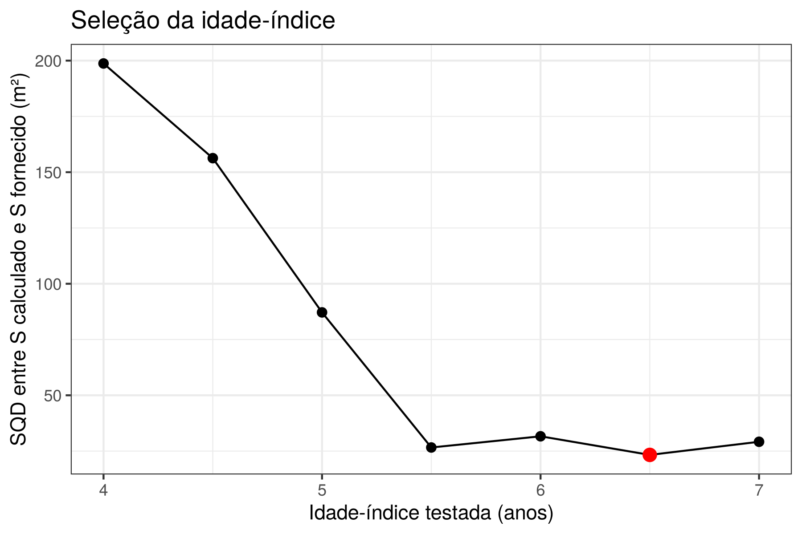
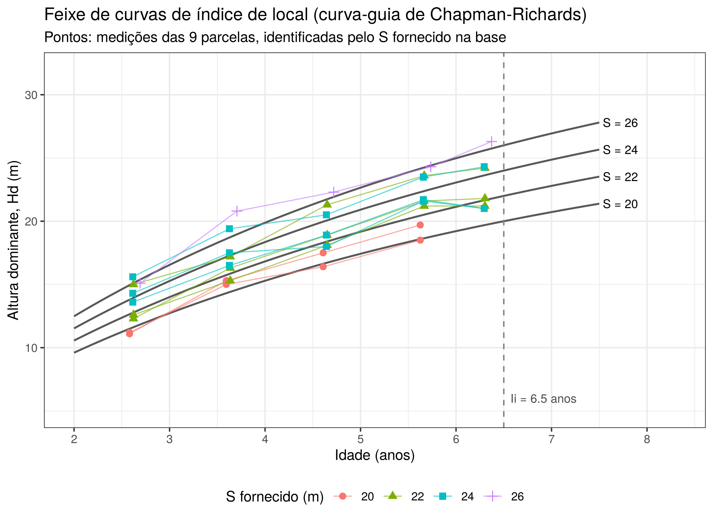

# Relatório — Desafio 08: validação do índice de local da base de Clutter

## 1. Objetivo

Verificar se o índice de local (S) já atribuído às 9 parcelas de `Dados_Clutter_original.xlsx` (projeto C531, talhões 1, 2, 3 e 6) pode ser reproduzido a partir dos dados de altura dominante (Hd) e idade, pelo método da curva-guia, antes de usá-lo no modelo de Clutter (Desafio 09).

## 2. Método

1. **Curva-guia.** O modelo de Chapman-Richards, Hd = b0·(1 − exp(−b1·idade))^b2, foi ajustado por mínimos quadrados não lineares (`nls`) às 43 medições agrupadas, usando apenas idade e Hd. A coluna S não entrou no ajuste.
2. **Índice de local.** Para uma idade-índice Ii, o S de cada parcela foi calculado por S = Hd·[(1 − exp(−b1·Ii)) / (1 − exp(−b1·idade))]^b2, com a medição de idade mais próxima de Ii.
3. **Seleção de Ii.** Foram testadas idades-índice de 4 a 7 anos, em passos de 0,5. O critério foi a menor soma de quadrados dos desvios (SQD) entre o S calculado e o S fornecido.
4. **Feixe de curvas.** Com a Ii selecionada, foram geradas as curvas Hd(t) = S·[(1 − exp(−b1·t)) / (1 − exp(−b1·Ii))]^b2 para S = 20, 22, 24 e 26 m.
5. **Verificações complementares.** O ajuste foi repetido com diferentes valores iniciais, o teste de Ii foi refeito com o modelo de Schumacher (ln Hd = a + b/idade) e o S calculado foi resumido por talhão.

## 3. Resultados

### 3.1 Curva-guia ajustada

| Coeficiente | Estimativa | Erro padrão |
|---|---|---|
| b0 | 34,0484 | 20,9039 |
| b1 | 0,1556 | 0,2629 |
| b2 | 0,8461 | 0,5262 |

R² = 0,787; R² ajustado = 0,777; Syx = 1,81 m (9,7%); n = 43.

O ajuste convergiu para a mesma solução a partir de quatro conjuntos de valores iniciais. Os erros padrão dos coeficientes, porém, são grandes e nenhum coeficiente é significativo a 5%. A causa é a faixa curta de idades (2,6 a 6,4 anos): nela, a curva é quase linear e a assíntota (b0) fica mal definida. Para calcular S dentro dessa faixa, o efeito é pequeno, mas a extrapolação para além de cerca de 6,5 anos deve ser feita com cautela.

### 3.2 Seleção da idade-índice

| Ii (anos) | SQD (m²) | Viés médio (m) | Desvio abs. médio (m) | Desvio abs. máximo (m) | Parcelas na mesma classe |
|---|---|---|---|---|---|
| 4,0 | 198,72 | −4,59 | 4,59 | 6,47 | 2 |
| 4,5 | 156,29 | −3,92 | 3,92 | 6,32 | 2 |
| 5,0 | 87,16 | −2,76 | 2,80 | 5,22 | 3 |
| 5,5 | 26,61 | −1,26 | 1,53 | 2,72 | 4 |
| 6,0 | 31,63 | −1,04 | 1,48 | 3,50 | 4 |
| **6,5** | **23,29** | **−0,08** | **1,23** | **2,66** | **5** |
| 7,0 | 29,18 | +0,73 | 1,58 | 3,46 | 4 |

A idade-índice selecionada é **6,5 anos**. Com idades-índice de 4 a 5 anos, o S calculado fica sistematicamente abaixo do fornecido (viés de −4,6 a −2,8 m), o que indica que o S da base foi definido numa idade mais avançada. A partir de 5,5 anos o SQD cai para a faixa de 23 a 32 m², e as diferenças entre 5,5, 6,0, 6,5 e 7,0 anos são pequenas. A curva do SQD não é suave porque a regra da "medição mais próxima" troca de medição conforme Ii: o talhão 1 não tem medição aos 6,3 anos, por exemplo.

### 3.3 Feixe de curvas de índice de local

### 3.4 Comparação entre o S fornecido e o S recalculado (Ii = 6,5 anos)

| Talhão | Parcela | Idade usada (anos) | Hd usada (m) | S fornecido (m) | S calculado (m) | Diferença (m) |
|---|---|---|---|---|---|---|
| 1 | 1 | 5,63 | 18,5 | 20 | 19,91 | −0,09 |
| 1 | 5 | 5,63 | 19,7 | 20 | 21,21 | +1,21 |
| 2 | 2 | 6,30 | 24,2 | 22 | 24,57 | +2,57 |
| 2 | 3 | 6,30 | 21,8 | 22 | 22,13 | +0,13 |
| 2 | 5 | 6,30 | 21,2 | 22 | 21,53 | −0,47 |
| 3 | 1 | 6,29 | 21,0 | 24 | 21,34 | −2,66 |
| 3 | 2 | 6,29 | 24,3 | 24 | 24,69 | +0,69 |
| 3 | 3 | 6,29 | 21,0 | 24 | 21,34 | −2,66 |
| 6 | 1 | 6,37 | 26,3 | 26 | 26,56 | +0,56 |

S calculado por talhão (média e amplitude entre as parcelas):

| Talhão | S fornecido | S calculado médio | Mínimo | Máximo |
|---|---|---|---|---|
| 1 | 20 | 20,56 | 19,91 | 21,21 |
| 2 | 22 | 22,74 | 21,53 | 24,57 |
| 3 | 24 | 22,45 | 21,34 | 24,69 |
| 6 | 26 | 26,56 | 26,56 | 26,56 |

## 4. Discussão

**Diferenças pequenas (compatíveis com arredondamento ou classe).** Em seis das nove parcelas, a diferença ficou entre −0,47 e +1,21 m. Como as classes da base têm 2 m de amplitude (20, 22, 24, 26), diferenças de até cerca de 1 m são compatíveis com o S ter sido arredondado para a classe mais próxima. O caso de T1-P5 (+1,21 m) está no limite.

**Diferenças grandes (não explicadas por arredondamento).** Três parcelas diferem em cerca de 2,6 m: T2-P2 (+2,57), T3-P1 (−2,66) e T3-P3 (−2,66). Uma diferença desse tamanho corresponde a mais de uma classe e não se explica por arredondamento.

**O S da base é atribuído por talhão, não por parcela.** Na base, todas as parcelas de um mesmo talhão têm o mesmo S. Os dados de Hd × idade, porém, mostram dentro do talhão 2 e do talhão 3 parcelas que seguem curvas de classes diferentes: o S calculado varia de 21,5 a 24,6 m no talhão 2 e de 21,3 a 24,7 m no talhão 3. A explicação mais provável é que o S original foi definido no nível do talhão. Pela média das parcelas, isso reproduz os talhões 1, 2 e 6 (médias de 20,6, 22,7 e 26,6 m, que caem nas classes 20, 22 e 26), mas não o talhão 3, cuja média (22,5 m) cairia na classe 22, e não na 24.

**A formulação do modelo não explica as diferenças.** O modelo de Schumacher produziu praticamente o mesmo padrão de SQD que o Chapman-Richards e também indicou 6,5 anos como a melhor idade-índice (SQD = 23,05 m², contra 23,29 m²; arquivo `saidas/sensibilidade_formulacao.csv`). Portanto, não há indício de que o S original tenha vindo de outra forma funcional da curva-guia. O caso do talhão 3 sugere que o S original pode ter usado informação que não está na base: uma curva-guia ajustada com mais parcelas da empresa, outra idade de referência ou um critério de agrupamento de talhões. Isso não pode ser confirmado com os dados disponíveis.

**Qualidade dos dados.** Nas parcelas T3-P1 e T3-P3, a Hd diminuiu entre as duas últimas medições (de 21,6 para 21,0 m e de 21,7 para 21,0 m). Uma redução de altura dominante não é biologicamente esperada e costuma indicar erro de medição ou troca das árvores dominantes amostradas. Como a regra da medição mais próxima de 6,5 anos usa justamente essas medições, as duas parcelas recebem S calculado menor, o que contribui para a diferença no talhão 3.

## 5. Conclusão e base para o Desafio 09

O S fornecido na base é **reprodutível em linhas gerais** com uma curva-guia de Chapman-Richards e idade-índice de cerca de **6,5 anos**: viés médio próximo de zero, seis de nove parcelas com diferença inferior a 1,3 m e os talhões 1, 2 e 6 corretamente classificados pela média das parcelas. As discrepâncias que restam se concentram no talhão 3 e na parcela T2-P2 e refletem a atribuição do S por talhão, e não um problema de formulação do modelo.

Para o Desafio 09, o grupo mantém o **S fornecido** na `base_consolidada_sitio.csv`, conforme a especificação, porque é a variável de sítio da base original do modelo de Clutter. O S recalculado fica documentado em `comparacao_sitio.csv`. Recomenda-se, no Desafio 09, verificar a sensibilidade das projeções do talhão 3 ao uso de S = 22 em vez de S = 24.
